

# MH3U Custom Quest Editor

Create and edit your own quests for **Monster Hunter 3 Ultimate** (3DS, **European or North
American** version), on **Citra** or on a real **3DS**. A small offline tool for Windows (and, untested,
macOS and Linux), written in pure Python, in **English or French**. It includes an optional **Monster
pack** (ROM hack) that lets large monsters appear on maps the game does not allow, like Zinogre on the
Sandy Plains.

New in 1.4: **who can join** (minimum Hunter Rank, number of players, no armor), **day or night**, the
fixed **Challenge gear** of the Challenge quests, and monsters that can start in **area 2 of the Great
Desert** with the Monster pack.

New in 1.3: start areas lit up on the area map, a monster browser by type and difficulty and an item
browser by family, an English / French interface with the game's own French names, monster sizes up to
2000 % with the Monster pack (untested in the game), and backups that clean themselves up without ever
touching your originals. See [CHANGELOG.md](CHANGELOG.md).

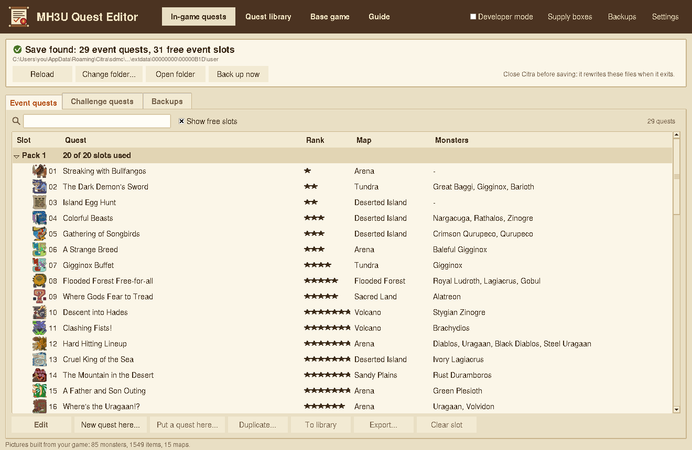

---

## ⚠️ Legal notice - please read first

* This is an **unofficial fan-made tool**. It is **not affiliated with, endorsed by or supported by
  Capcom or Nintendo**. *Monster Hunter* is a trademark of Capcom Co., Ltd.
* **This repository contains no game**: no ROM and no extracted game file. To use the editor you
  must **own a legal copy of Monster Hunter 3 Ultimate and dump it yourself** from your own console
  or cartridge. It does include the small monster, item and map pictures the editor displays; they are
  Capcom's artwork and stay Capcom's property (see [THIRD_PARTY.md](THIRD_PARTY.md)).
* **Never share** ROMs, extracted game files or your save files, and do not attach them to Issues or
  Discussions.
* **Use at your own risk.** Editing quest files can corrupt a save or crash the game. The code is
  provided "as is" under the MIT licence, without warranty. **Keep backups** (see
  [What the editor changes and what to back up](#what-the-editor-changes-and-what-to-back-up)).
* The optional **Monster pack** is a ROM hack: it patches the game's code through a mod
  (`exefs/code.ips`). It is built on your PC from your own game and never distributed; it is
  experimental, see [Monster pack (ROM hack)](#monster-pack-rom-hack).
* Please do not use modified quests to disturb other players online.

More in [SECURITY.md](SECURITY.md) and [THIRD_PARTY.md](THIRD_PARTY.md).

## Contents

1. [What it does](#what-it-does)
2. [Requirements](#requirements)
3. [Installation](#installation)
4. [Quick start: your first custom quest](#quick-start-your-first-custom-quest)
5. [What the editor changes and what to back up](#what-the-editor-changes-and-what-to-back-up)
6. [Monster pack (ROM hack)](#monster-pack-rom-hack)
7. [Real 3DS](#real-3ds)
8. [What was tested, and what was not](#what-was-tested-and-what-was-not)
9. [Advice](#advice)
10. [Share your experience](#share-your-experience)
11. [Troubleshooting](#troubleshooting)
12. [Command line, tests and tools](#command-line-tests-and-tools)
13. [Security, credits and licence](#security-credits-and-licence)

## What it does

The editor writes quests straight into the **event quest** slots of your save (3 packs of 20 quests)
or the **challenge quest** pack, where the game lists them like its own event quests. You pick a
quest to start from, then change what you like. Next to every setting there is an **(i)** that says
what it does, with the values the game's own quests use; the built-in **Guide** (tabbed) and
[docs/GUIDE.md](docs/GUIDE.md) explain every setting.

| Page | What it is |
|---|---|
| **In-game quests** | The quest files of your save: *Event quests* (packs 1-3), *Challenge quests* (pack 4) and *Backups*. Edit, new quest, put a quest from the library, duplicate, export, clear a slot. |
| **Quest library** | Your quests kept on your PC as `.mh3uq` files, to keep, share and send back to a slot. |
| **Base game** | Optional: edit the game's own Village and Port quests as a Citra mod (the ROM is never changed). |
| **Monster pack** | Optional ROM hack: build and install the pack that lets large monsters start on any map. |
| **Guide** | Tabs: Getting started, General, Monsters, Supply Box, Rewards and Text, Game values, Monster pack, Files and backups, Tested or not. |

### Features

* **General:** star rank, map, time limit, fee, reward and penalty, HR points, objectives (set for you
  from the monsters, or by hand), stable or unstable environment, **day or night**, **who can join**
  (Hunter Rank minimum, at most 1-3 players, no armor or talismans, with the matching quest-board
  line), other gameplay settings.
* **Challenge gear:** the 5 fixed gear sets (weapon, armor, talisman and skills, pouches) and the S / A
  rank times of the Challenge quests and Grudge Matches. MH3U has no weapon-type rule for other quests:
  there the hunters always use their own gear.
* **Monsters:** up to 5 large monsters, with *How the monsters arrive* (all at the start, one after
  another, in groups), **Size like** (tiny to giant, King Size), **Strength like** (health, attack and
  toughness taken from the game's quests by hub and star rank), and the small monsters of the zone.
* **Supply Box:** the game's boxes, or **your own named boxes** (any items; the game has room for 10).
* **Rewards:** auto-fill from the game's own quests by monster and rank, then edit freely.
* **Text:** quest name, client, description, objectives in the 5 languages.
* **Safety:** checks that warn about mistakes that can stop a quest from loading, **automatic backups
  before every save**, a copy of the original files that is never deleted, *Undo changes*.
* **Where they start, on the map:** each monster card shows the area map with its start area in yellow;
  the big map has a pin on every start area of that monster, click one to choose it. *Hunters start*
  (General tab) shows where the hunters begin, with the game's odds, on the map too.
* **Browsers:** monsters grouped by type (Flying Wyverns, Brute Wyverns...) with the easiest first and
  difficulty stars, or listed by difficulty; items grouped by family (healing, bombs and traps, ores,
  monster parts, jewels...) following the game's icons. Search finds anything.
* **Monster pack (ROM hack, optional):** 47 large monsters on all 14 maps (497 new combinations), and
  monster sizes above the game's 255 % limit, up to 2000 % (Developer mode; untested in the game).
* **Game versions:** European (EU) and North American (US); choose yours in *Settings*.
* **English or French** (*Settings > Language / Langue*): the interface, the guide and the checks, with
  the game's own French names for items, monsters and maps.
* **Backups that tidy up:** old backups are deleted automatically (how many to keep is in *Settings*),
  but never your original files, the first full backup or the first copy of each quest.
* Two themes: *Moga Parchment* (light) and *Tanzia Night* (dark). *Developer mode* shows raw fields and
  the risky settings; the normal mode keeps to what a quest maker needs.

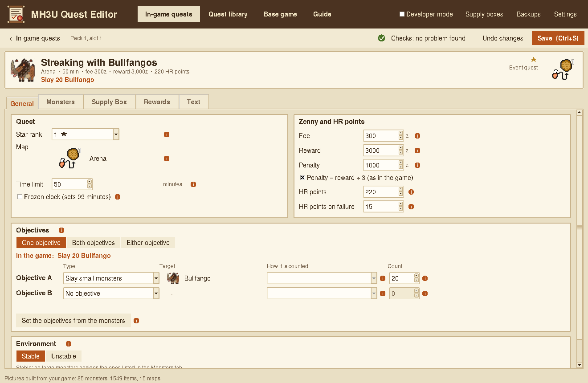
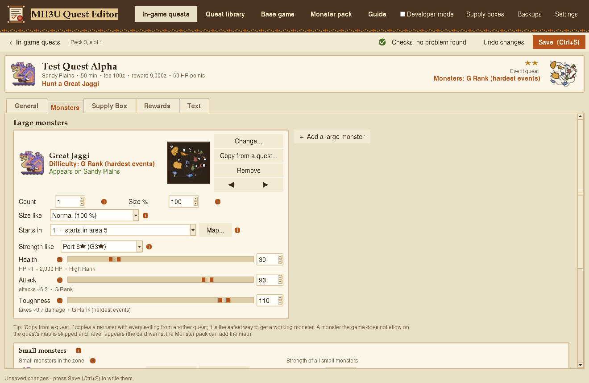

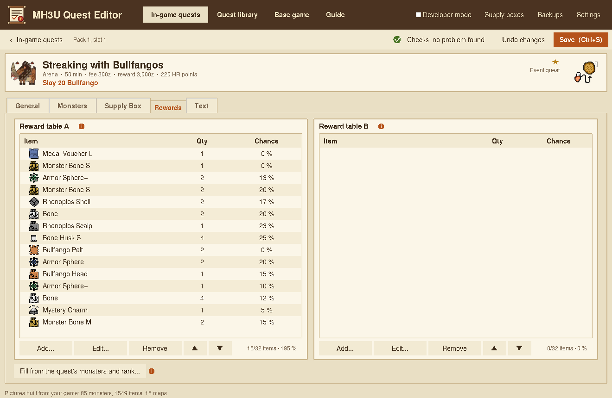
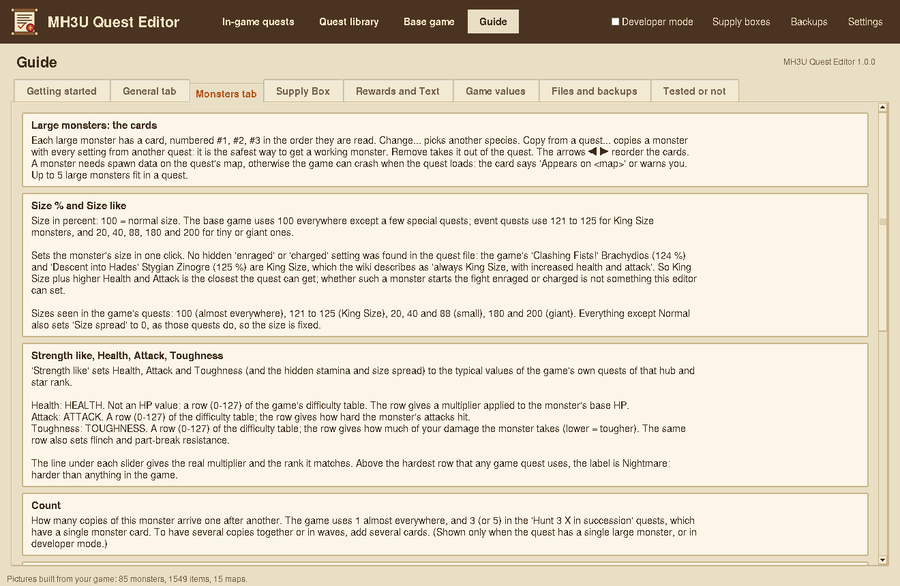

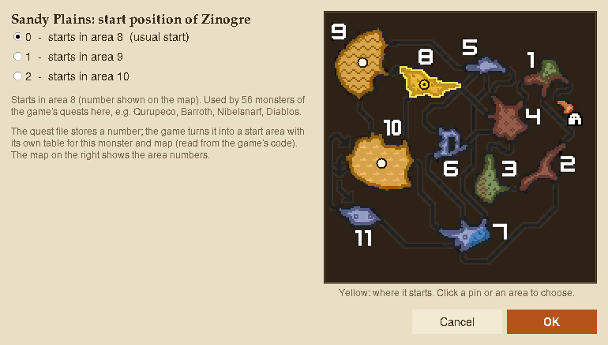
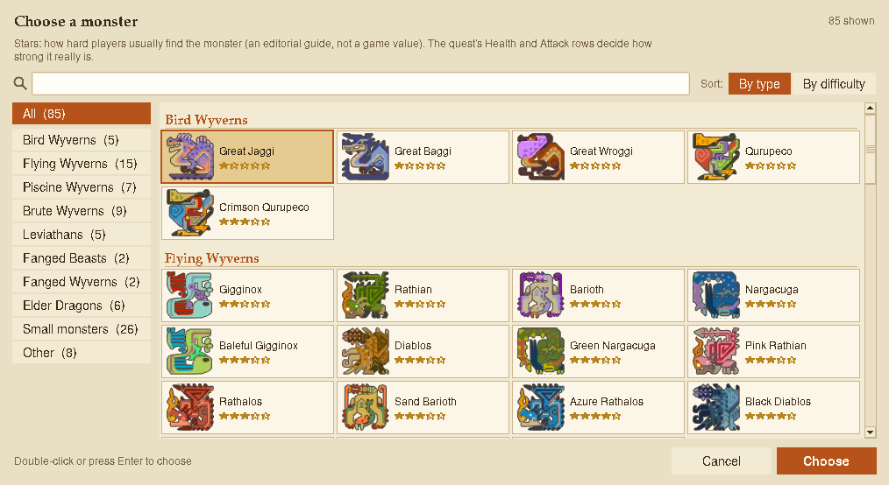

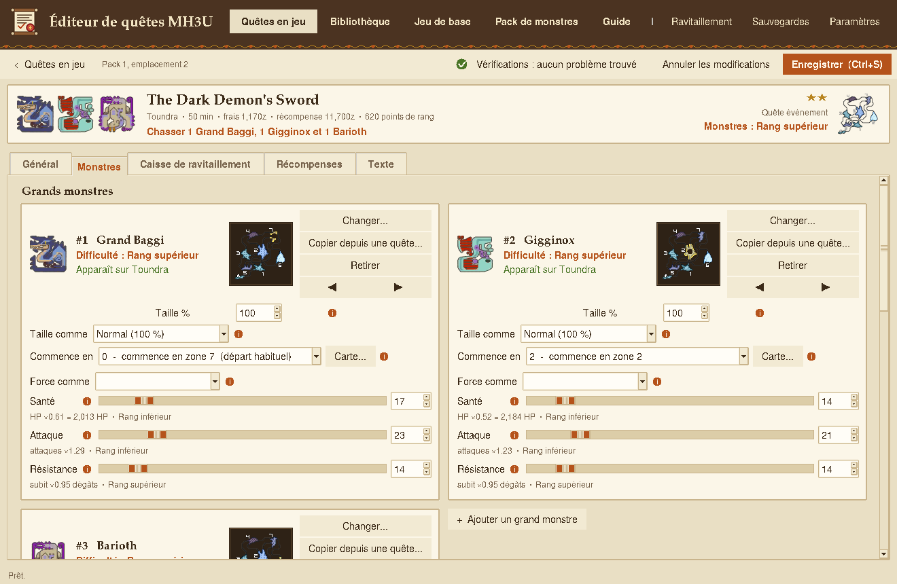
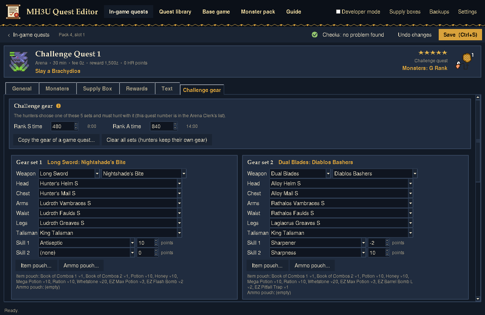

## Requirements

| | |
|---|---|
| **Game** | Your own legal copy of *Monster Hunter 3 Ultimate*, **European** (title id `00040000000B1D00`) or **North American** version (`00040000000AE400`). Choose yours in *Settings > Game version*. The Japanese version was not studied. |
| **To play** | **Citra** (or a fork: Azahar, Lime3DS...) **or** a real 3DS with custom firmware and a save manager such as **Checkpoint** / JKSM. |
| **Computer** | **Windows** (tested), **macOS** or **Linux** (untested). **Python 3.10 or newer** with **tkinter** (the installer from python.org includes it). |
| **Optional** | The game's extracted **`romfs`** folder: needed for the *Base game* page and to copy the game's own quests as templates. |
| **Optional** | **Pillow** (`py -m pip install pillow`) and `exefs/code.bin`, only to rebuild the pictures from your own game. |
| **Optional** | The extracted game **with `exefs/code.bin` next to `romfs`**, to build the *Monster pack*. |

No internet connection is needed to run the editor, and it never uses one.
The author tested on **Windows with Citra** only. macOS and Linux: the code is portable Python, has a
launcher for each, and looks for Citra, Azahar and Lime3DS folders there too (including Flatpak), but
nobody has tried yet.

## Installation

1. **Install Python 3.10+** from <https://www.python.org/downloads/>. In the installer keep
   *tcl/tk and IDLE* ticked (default) and tick *Add python.exe to PATH*.
2. **Download this repository** (green *Code* button > *Download ZIP*, or `git clone`) and unzip it
   anywhere you can write (not inside *Program Files*). Keep the folder together: the editor writes
   its settings, backups and library next to itself.
3. **Start** it by double-clicking **`Launch Quest Editor.bat`** (or `python mh3u_quest_editor.py`).
   Run `Create shortcut.bat` once if you want a Desktop shortcut with the icon.
   **macOS:** double-click **`Launch Quest Editor.command`** (the first time: right-click > *Open*).
   Python from python.org includes Tk; with Homebrew install `python-tk`.
   **Linux:** run **`./launch_quest_editor.sh`**. Tk usually comes as a separate package
   (`sudo apt install python3-tk` on Debian/Ubuntu, `sudo dnf install python3-tkinter` on Fedora).
4. **First start:** the editor finds your Citra save by itself. Start MH3U once in Citra and close it
   first if it says *Not found yet*. Then choose a theme.
5. **Optional, for the Base game page and to copy the game's own quests:** extract the game's files
   from **your own** copy, for example with Citra (right-click the game in the list > *Dump RomFS*), or
   with GodMode9 / a 3DS extraction tool on your console. Then in the editor:
   *Settings > Choose the romfs folder...*. The monster / item / map pictures are already included;
   *Settings > Rebuild the pictures from my game...* can regenerate them.

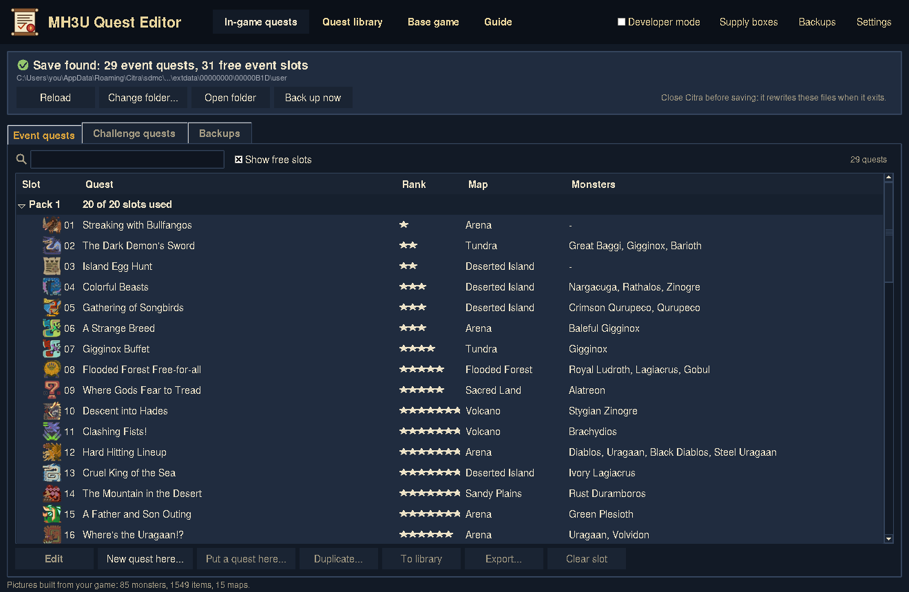

## Quick start: your first custom quest

1. **Close Citra.** It rewrites the quest files when it exits and would overwrite your work.
2. Back up your save's quest files (see below), then open **In-game quests > Event quests**.
3. Select a **free slot**, press **New quest here...**, and pick a quest to copy, preferably one on the
   **same map** with similar monsters (the end of a quest file holds map-dependent data), and name it.
4. Change the tabs *General*, *Monsters*, *Supply Box*, *Rewards*, *Text*. Hover the **(i)** icons.
5. Press **Save** (Ctrl+S). A full backup is made first.
6. Start the game: your quest is in the event quest list.

If the game freezes or a quest does not appear, restore the backup (In-game quests > *Backups*) and
read [Troubleshooting](#troubleshooting).

## What the editor changes and what to back up

**Everything the editor can write, and where:**

| What | Where | When |
|---|---|---|
| **Your save's quest files** `quest1`, `quest2`, `quest3` (event quests) and `quest4` (challenge quests) | `C:\Users\<you>\AppData\Roaming\Citra\sdmc\Nintendo 3DS\<id0>\<id1>\extdata\00000000\00000B1D\user` (EU) or `...\00000AE4\user` (US), found automatically | Every *Save*, *Put a quest here*, *Clear slot*, *Restore* |
| **Optional mod folders** (your own supply boxes; edited Village / Port quests) | `output\MH3U_Supply_Mod\romfs` and `output\MH3U_Quest_Mod\romfs` next to the editor; copied into `<Citra>\load\mods\<title id>\romfs` only when you press the install buttons | Only if you use those features |
| **Monster pack (ROM hack)** | `output\MH3U_Monster_Pack_EU` (or `_US`) next to the editor; copied into `<Citra>\load\mods\<title id>\` (`romfs\arc\enemy\` 47 files, `exefs\code.ips`, `mhqe_monster_pack.json`) only when you press *Install in Citra*; *Remove from Citra* deletes exactly those files | Only if you build and install it |
| **The editor's own files** | next to the program: `settings.json`, `custom_supply.json`, `backups\` (`backups\us\` for the US version), `library\`, `error_log.txt`, and `assets\` if you rebuild the pictures | Always |

Title id: `00040000000B1D00` (EU) or `00040000000AE400` (US). It **never** modifies your ROM, your
extracted `romfs` / `exefs`, or anything else on your computer.

**What you should back up yourself, before your first save:**

1. The **`user` folder** above (it holds `quest1`..`quest4`): copy it somewhere safe. This is your
   quests' state; the editor's own backups are in the editor's folder, but a copy you made yourself
   cannot be touched by a bug.
2. If you use mods: `<Citra>\load\mods\<title id>`.
3. Your **whole save** if you play on a real 3DS (Checkpoint / JKSM), or Citra's `sdmc` folder.
4. Your **`library\`** folder (your quests) and `custom_supply.json` from time to time.

**The editor's backups** (In-game quests > *Backups*): a full backup of `quest1`..`quest4` before every
save (`backups\full\`), a copy of each quest it replaces, edits or clears (`backups\quests\`), and the
very first version of each file (`backups\original\`, never deleted). Restoring a backup backs up the
current files first.

## Monster pack (ROM hack)

The game keeps, **inside its program** (`code.bin`), a table of the maps where each large monster may
start a quest; on any other map the monster is silently skipped. Each monster's own file also holds
its spawn areas, routes and special moves per map. The *Monster pack* page builds, **from your own
extracted game**, a mod that gives 47 large monsters every map they are missing (497 combinations, all 14
maps): for each new map it borrows the start positions and map data of a monster that lives there,
and picks the game's start list offering the most start areas.

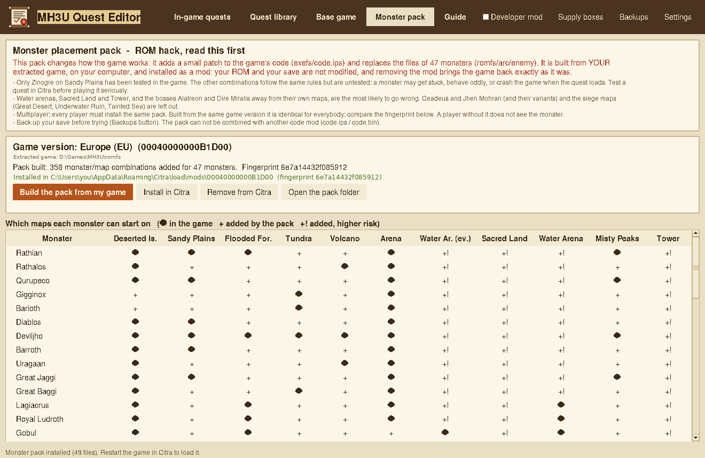

* **What it changes:** a 7 KB patch `exefs/code.ips` (new start lists and the extended size table,
  written in unused space of the program and over the old lists they replace, one pointer per monster
  and one for the size table) and 47 files
  `romfs/arc/enemy/emNNN.arc`. It is a mod: the
  ROM and the save are untouched, and *Remove from Citra* brings the game back exactly. It cannot be
  combined with another `code.ips` / `code.bin` mod.
* **Left out:** Ceadeus, Goldbeard Ceadeus, Jhen Mohran and Hallowed Jhen Mohran stay on their own
  maps. The siege maps are open to the others, following the game's own example (on the Underwater
  Ruin a monster gets only a start point in area 3, like Abyssal Lagiacrus in the game).
* **Tested:** only **Zinogre on Sandy Plains** (Citra). Everything else follows the same rules but is
  **untested**: a monster may get stuck or the game may crash. Water arenas, Sacred Land, Tower, the
  siege maps, and Alatreon / Dire Miralis away from their maps are the riskiest (marked `+!`).
* **Great Desert, area 2:** in the Jhen Mohran fight the sand ship moves from area 1 to area 2, so a
  monster left in area 1 is out of reach. The pack gives the other monsters a start in area 2 there
  (start 1 in the card's *Starts in* list). Untested in the game.
* **Big sizes:** a quest stores a monster's size in one byte (255 % at most). The game then adds a value
  from a size table chosen by the quest, with no upper limit; the pack extends that table with exact
  sizes from +100 % to +1900 %, so *Size %* accepts up to **2000 %** in Developer mode. Such a quest needs
  the pack installed. Checked against the game's code, **not tried in the game**: a giant may clip
  through walls or be hard to reach.
* **Multiplayer:** every player needs the same pack. Built from the same game version it is identical
  for everybody: compare the **fingerprint** on the page.
* **Real 3DS:** copy the content of the pack folder into `luma\titles\<title id>\` (game patching
  enabled in Luma). Untested on hardware.
* **Without the editor window:** `python tools/build_monster_pack.py --romfs <romfs> --out <folder>`.

## Real 3DS

The editor works on the save's extra data files, so on a real console:

1. Use **Checkpoint** (or JKSM) to back up MH3U's save data/extra data. Copy it to your PC.
2. In the editor, *In-game quests > Change folder...* and pick the copied `...\extdata\00000000\00000B1D\user`
   folder (`00000AE4` for the US version).
3. Edit and save. Copy your back-up first, as above.
4. Restore the changed data to the 3DS with Checkpoint.
5. Custom supply boxes and edited base-game quests are **romfs mods**: copy their `output` folder into
   `luma\titles\<title id>\romfs` on the SD card (Luma3DS game patching must be enabled). Without
   those files the game just shows its own boxes.

The author has **not** tried this on real hardware yet (this is a first version): the files are the same
as Citra's, but please tell how it went. Everyone who plays a quest together needs the same quest and
the same mod files.

## What was tested, and what was not

The author could test on **Citra (European version, Windows)** only; this table says honestly what
rests on a test in the game and what rests on reading the game's files.

| Topic | Status |
|---|---|
| Saving quests into event slots and loading them in the game | ✅ Tested in Citra |
| Arrival patterns "one after another", "the first, then the other two together", "the first two together, then the last" | ✅ Tested in Citra |
| "All at the start": the quest ends when the *target* monsters are slain | ✅ Tested in Citra |
| Time limit: up to **98 min** the clock counts down, from **99 min** it is frozen | ✅ Tested in Citra (values above 120 untested) |
| *Environment: Unstable* appears on the quest board when the chance of roaming monsters is above 0 | ✅ Tested in Citra |
| A monster on a map the game does not allow is skipped (never appears); with the Monster pack, Zinogre appears on Sandy Plains | ✅ Tested in Citra |
| The other 496 combinations of the Monster pack | 🔎 Built and checked by the tests (same rules as the tested one), not played: please test and report |
| *Starts in*: start areas per monster and map; *Hunters start* odds | 🔎 Read from the game's code (3DS); identical to the Wii U tables, where random and fixed hunter starts were confirmed in the game by mh3u-quest-studio. Map numbers collected in that game by the same project |
| **North American (US) version** | 🔎 Compared file by file with the EU version (same quest format, base quests, monster files and pack; different program id, save folder `00000AE4` and `us` folder). Not played: please report |
| Quest fields: meaning of most settings, objectives, rewards, supply boxes | 🔎 Read from the game's own quests (the **(i)** says "not confirmed" where that is all there is) |
| Three monsters arriving at once; five monsters one after the other | 🔎 Follow the same rule as the tested patterns but never appear in a game quest: please test |
| Which monsters wander into an *Unstable* zone | ❌ Cannot be chosen: the list is stored in the game, not in the quest |
| An "enraged" / "charged" monster | ❌ No such setting was found in the quest file. King Size (+ health and attack) is the closest |
| Start areas on the map (yellow areas, pins) | 🔎 Area outlines from the game's map pictures, placed with mh3u-quest-studio's area markers (they line up on every map); the start areas themselves come from the game's code |
| Who can join (HR, players, no armor) and the quest-board line | 🔎 Rules table from mh3u-quest-studio (confirmed in the Wii U game); every 3DS quest pairs rules and board lines the same way. Not tried with a custom quest |
| Day / night | 🔎 Every game quest sets exactly one of the two flags; night quests are the ones whose texts speak of the night. Not tried with a custom quest |
| Challenge gear | 🔎 Layout from mh3u-quest-studio, checked on the 3DS Challenge quests (names and sets read back correctly). Editing not tried in the game |
| Great Desert area 2 (Monster pack) | 🔎 Uses Jhen Mohran's own area-2 spawn data; not tried in the game |
| Monster sizes above 255 % (Monster pack) | 🔎 The size code and table were read in the 3DS program and the patched table checked by the tests; **not tried in the game** |
| French interface | 🔎 Interface, checks and guide translated; item, monster and map names from the game's French text. A few rare texts may still show in English |
| **Real 3DS**, Japanese version, Linux, macOS | ❔ Not tested by the author: you may be the first to find out. Please report |

## Advice

* **Back up first**, and again whenever you reach a quest you are proud of.
* **Close Citra before you save**; it rewrites the quest files when it exits.
* **Copy a quest on the same map** as the one you want. The game lets each monster start only on some
  maps, otherwise it skips it (the monster card tells you: *Appears on <map>*); the *Monster pack* can
  add the missing maps.
* **Change a few things at a time** and test in the game. Keep one slot per experiment.
* Use *Strength like* and *Size like* instead of typing raw numbers; the rows are the game's own.
* Start with the *Monsters* tab's **Copy from a quest...** to get a monster with every setting the
  game gives it.
* Watch the **checks badge** in the top bar: it warns about things that can stop a quest from loading.
* Test on Citra before a real 3DS.
* Share quests as **`.mh3uq`** files from the library, never the raw save files.

## Share your experience

This editor was made by one person who could not test everything. **Your feedback is what makes it
better.** Please:

* open an **Issue** for a bug, a crash or a quest that does not load (what you did, `error_log.txt`,
  Citra or 3DS), or for something unclear in an **(i)** explanation;
* start a **Discussion** (or an Issue if Discussions are off) to tell what you made, what you
  tested on real hardware, which settings behave differently from what the guide says, and which
  ideas you want;
* **share your quests** as `.mh3uq` files (only ones you created or changed: a quest copied unchanged from
  the game is Capcom's data) and your findings, so that everyone can learn from them.

**Please never attach game files** (ROM, `romfs`, `quest1`..`quest4`, `.supp`).

## Troubleshooting

| Problem | What to try |
|---|---|
| The window does not open | Check *Python 3.10+ with tkinter* (`python -m tkinter` opens a small window). Run `python mh3u_quest_editor.py` from a console to see the message; `error_log.txt` may exist. |
| "Not found yet" on the first start | Start MH3U in Citra once, close Citra, press *Find automatically*. Or *Choose the folder myself...* and select the `...\extdata\00000000\00000B1D\user` folder. |
| My quest is not in the game | Citra must be **closed** when you save. Check the slot (packs 1-3 = event quests; pack 4 = challenge quests). |
| A monster never appears | The game does not allow it on that map (the card warns): change the map, or build and install the *Monster pack*. With the pack: was the game restarted after installing it? |
| The game freezes when loading a quest | The quest is based on a different map, or (with the Monster pack) the combination does not work: restore the backup and copy a quest of the same map, or try another start position or map. Please report combinations that crash. |
| I chose the wrong version | *Settings > Game version*: each version has its own save folder, extracted game and backups. |
| Empty pictures | The `assets` folder is incomplete: download the repository again, or *Settings > Rebuild the pictures from my game...* (needs `romfs`, Pillow, optionally `exefs/code.bin`). |
| The supply box / game quests show the game's own contents | The mod files are not installed in Citra (`load\mods\<title id>\romfs`), or not on the SD card for a 3DS. |
| I want everything back as it was | *In-game quests > Backups*, restore `original`, or copy your own backup of the `user` folder. |

## Command line, tests and tools

The editor needs nothing but the `.bat` / `python mh3u_quest_editor.py`. For developers:

    python tools/build_assets.py --romfs <romfs> [--code <exefs/code.bin>]   # rebuild the pictures from your game
    python tools/build_guide_md.py                                          # regenerate docs/GUIDE.md
    python tools/make_icon.py                                               # regenerate the app icon
    python tools/build_monster_pack.py --romfs <romfs> --out <folder>       # build the Monster pack
    python tools/build_map_zones.py <mh3u-quest-studio>/data/art_layout.json # area centres of the maps
    python tools/build_fr_names.py <romfs>                                   # the game's French names
    python tools/build_equipment.py <romfs>                                  # weapon / armor / skill names

`tools/build_benchmarks.py`, `build_spawns.py` and `build_start_usage.py` rebuild the tables in
`data/` from your extracted game. **The tests need your own game files** (nothing of the game is in
the repository), and skip what they cannot find:

    set MHQE_QUEST_DIR=...\romfs\quest\eu
    set MHQE_ROMFS_US=...\romfs of the US version (optional)
    set MHQE_PACK_DIR=...\extdata\00000000\00000B1D\user
    set MHQE_ROMFS=...\romfs
    set MHQE_ARC=...\romfs\arc\quest\eu\quest00.arc
    set MHQE_CODE_BIN=...\exefs\code.bin
    python -m unittest discover -s tests -v

Layout: `mhqe/quest.py` (quest record), `packs.py` (event packs), `arc.py` (archives), `project.py`,
`backup.py`, `library.py`, `validate.py`, `supp.py` (supply files), `autofill.py`, `waves.py` (arrival
patterns and objectives), `spawns.py`, `strays.py`, `artbuild.py` (pictures), `guide.py` /
`helptext.py` (texts), `monsterpack.py` (Monster pack: placement table, monster stage tables, size
table, IPS), `catalog.py` (monster types, difficulty, item families), `i18n.py` (English / French),
`zonemap.py` (area maps), `app.py` / `editor.py` / `picker.py` (interface). `data/` holds the fact
tables; `data/lang/` the French texts. `tests/gui_lang.py` opens the main screens in one language.

## Security, credits and licence

* **Security and legal:** [SECURITY.md](SECURITY.md). The editor is offline and only touches the folders listed above.
* **Credits:** the quest record layout and several tables started from
  [mh3u-quest-studio](https://github.com/Matt-Wood-23/mh3u-quest-studio) by Matt Wood (MIT), whose
  later work also gave the game's names of the settings fields, the in-game map numbers of the areas,
  the area markers of the maps and the hunters' start table that this version checks against the 3DS
  game; the
  [MH3U wiki](https://monsterhunter.fandom.com/wiki/Monster_Hunter_3_Ultimate) was used to cross-check
  names. Interface layout inspired by the MH4U Custom Quest Editor. Details in [THIRD_PARTY.md](THIRD_PARTY.md).
* **Licence:** MIT for the code and original files ([LICENSE](LICENSE)); the game and Capcom's
  artwork (the small pictures in `assets/`) belong to Capcom and are not covered by it. Version history: [CHANGELOG.md](CHANGELOG.md).
